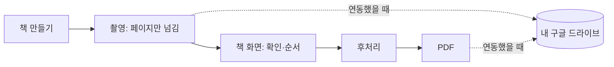

# 북스캔 (bookscan)

- **무엇**: 안드로이드 크롬에서 책을 펼쳐 두고 페이지만 넘기면 자동으로 찍히는 웹앱(PWA)입니다. 서버가 없습니다.
- **누가 읽나**: 앱을 쓰고 배포·설정하는 사용자(1~3장), 이어서 개발할 사람(4장).
- **현재 단계**: Phase 1(자동 촬영)·2(드라이브 백업)·3(후처리) 구현을 마쳤습니다. 실제 휴대폰 확인은 아직입니다. AI 후처리(Phase 4)는 보류입니다.
- **주소**: https://jju1512.github.io/bookscan/ (저장소 https://github.com/jju1512/bookscan)
- **기준 문서**: 요구사항 [docs/SPEC.md](docs/SPEC.md), 작업 상태·결정 [HANDOFF.md](HANDOFF.md)



## 1. 사용법

### 책 만들기와 촬영

1. 첫 화면에서 **+ 새 책** → 제목을 쓰고 촬영 단위를 고릅니다.
   - **양쪽 펼침**(기본): 두 페이지를 한 장으로 찍고, 후처리에서 좌우로 나눕니다.
   - **한 페이지**: 한 번에 한 페이지만 찍습니다.
2. 책 화면에서 **촬영 시작**을 누르고, 휴대폰을 거치대에 고정합니다.
3. 페이지만 넘기면 자동으로 찍힙니다. 화면 위 상태 표시가 바뀝니다.
   - **대기 · 페이지를 넘기세요** → **넘김 감지** → **확인 중** → **촬영**
4. 직접 찍으려면 화면 탭, **찍기** 버튼, 블루투스 키보드의 Enter·Space 중 하나를 씁니다.
5. 다 찍으면 **끝내기**로 책 화면에 돌아갑니다.

- **일시정지/재개**: 자동 촬영만 멈춥니다. 수동 촬영은 됩니다.
- **플래시**: 기기가 지원할 때만 버튼이 보입니다.
- **촬영됨 표시**: 기기에 저장이 끝난 뒤에만 셔터음·진동·테두리 깜빡임이 나옵니다.
- **탭 전환**: 다른 앱이나 탭으로 가면 카메라를 끄고, 돌아오면 다시 켭니다.

### 책 화면

- **썸네일**을 누르면 크게 봅니다. 그 안에서 **이전/다음**, **재촬영**, **삭제**를 합니다.
- **재촬영**: 다시 찍은 사진이 원래 자리에 들어갑니다.
- **◀ ▶**: 촬영 순서를 바꿉니다.
- **촬영 끝내기 / 촬영 다시 열기**: 책의 촬영 상태를 바꿉니다.
- **ZIP 내보내기**: 원본과 책 정보를 ZIP 하나로 받습니다. 첫 화면의 **ZIP 가져오기**는 항상 새 책으로 만듭니다.
- **로컬 정리**: 설정에서 켤 때만 보입니다. 드라이브 업로드와 후처리가 모두 끝난 원본만 이 기기에서 지웁니다.

### 후처리와 전후 비교

책 화면의 **후처리**를 누릅니다. 단계는 자르기·분할 → 손가락 지우기 → 펴기 → 화질 보정 → OCR(글자 인식) 순입니다.

1. 위쪽 체크 상자로 단계를 켜고 끕니다. 끈 단계는 앞 단계 결과를 그대로 씁니다.
2. **처리 시작**을 누릅니다. **멈춤**, **이어서 처리 (N쪽 남음)**으로 멈추고 이어 갑니다.
3. 진행 막대와 "N/M쪽 · 남은 시간"을 봅니다. 화면이 켜져 있을 때만 진행합니다.
4. 페이지마다 **수동 보정**, **다시 처리**, **이 페이지 건너뛸 단계**를 고릅니다.
5. 책 전체가 끝나면 PDF를 자동으로 만듭니다. **PDF 내려받기**로 받습니다. 드라이브 연동 중이면 PDF도 올립니다.

- **손가락이 글자를 덮음**: 지우지 않고 표시만 합니다. **다시 찍기**를 권합니다.
- **수동 보정 필요**: 책 외곽을 못 찾은 페이지입니다. 수동 보정에서 꼭짓점 4개와 가운데 선을 끌어 맞추고 **저장하고 다시 처리**를 누릅니다.
- **전후 비교**: 원본과 결과를 나란히 봅니다. 나쁜 페이지에 표시하고 "어느 단계부터"를 고른 뒤 **표시한 페이지 다시 처리**를 누릅니다.

### 설정

첫 화면의 **설정**에서 바꿉니다.

| 항목 | 뜻 |
|---|---|
| 촬영 방식 | **자동**: 사진 촬영 기능(takePhoto)을 쓰다가, 1초를 넘기거나 실패하거나 미리보기가 0.6초 넘게 멈추면 카메라를 다시 켤 때까지 미리보기 화면 캡처로 바꿉니다. **takePhoto 만** / **스트림 프레임 캡처만**은 한 방식만 씁니다. |
| 새 책의 기본 촬영 단위 | 양쪽 펼침 또는 한 페이지 |
| 셔터음, 진동 | 촬영됨 알림을 켜고 끕니다 |
| 후처리 단계 | 다섯 단계를 켜고 끕니다. "흑백으로 바꾸기"는 글자만 있는 책에 좋고, 그림이 많으면 끕니다 |
| 저장 | "로컬 정리" 버튼 보이기 (기본 꺼짐) |
| 구글 드라이브 백업 | **연동하기**, **연동 해제**, **다른 기기의 책 불러오기** (2장의 구글 설정을 마친 배포에서만 보입니다) |

- 처음 열 때 드라이브 백업 여부를 묻습니다(구글 설정을 마친 배포만). **나중에**를 골라도 설정에서 바꿀 수 있습니다.
- **다른 기기의 책 불러오기**: 휴대폰에서 찍어 드라이브에 올린 책을 PC 크롬에서 받아 후처리합니다.

### 디버그 패널과 후처리 비교 페이지

자동 촬영이 잘 안 맞을 때 오른쪽 위 **디버그**를 엽니다. 주소 끝에 `?debug`를 붙이면 열린 채 시작합니다.

- **그래프**: motion·change·sharpness 실시간 값, 상태 띠, 촬영 시점 표시
- **상태 전환 로그**와 **파라미터** 편집(**저장**, **기본값으로**)
- **세션 녹화**: 미리보기를 640px webm 영상으로 내려받습니다.
- **녹화 재생**: 같은 영상을 파라미터만 바꿔 다시 돌려, 촬영 시점을 나란히 비교합니다.
- **로그 내보내기**: 문제를 알릴 때 첨부합니다.

후처리 결과는 설정의 **후처리 비교 페이지**(주소 `/debug/compare/`)에서 단계별로 모아 봅니다. 내장 합성 샘플, 직접 고른 이미지, 이 기기의 책 중에서 고릅니다.

## 2. 저장, 배포, 구글 설정

### 저장과 안전

- **보관 위치**: 이미지는 이 기기의 브라우저 저장소(OPFS)와, 연동했다면 본인 구글 드라이브에만 있습니다.
- **새로고침**: 찍은 사진은 남고, 업로드와 후처리는 다음에 이어서 합니다.
- **원본**: 사용자가 지우기 전까지 지우지 않습니다(삭제, 책 삭제, 로컬 정리).
- **떠날 때**: 저장·업로드·후처리가 남아 있으면 페이지를 떠나기 전에 경고합니다.
- **새 버전**: 화면 아래 "새 버전이 있습니다 [새로고침]"을 누를 때만 바뀝니다.

> [!WARNING]
> 시크릿 모드에서는 "탭을 닫으면 사라집니다" 경고가 뜹니다. 일반 창이나 설치한 앱으로 쓰세요.
> 영구 저장이 거부되면 공간이 부족할 때 브라우저가 데이터를 지울 수 있습니다. 홈 화면에 설치하면 보통 허용됩니다.
> 여유 공간이 150MB 아래면 촬영 전에 경고합니다. 중요한 책은 ZIP으로 내보내 두세요.

### 배포 (GitHub Pages)

- **자동 배포**: `main`에 push하거나 Actions에서 수동 실행하면 `npm ci → npm test → npm run build → 배포`를 합니다. PR은 빌드까지만 합니다. 워크플로는 `.github/workflows/pages.yml`입니다.
- **Pages 켜기**: Settings → Pages → Source가 **GitHub Actions**여야 합니다. 꺼지면 `configure-pages` 단계에서 실패합니다.
- **경로**: 빌드 때 환경변수 `BASE_PATH`로 정합니다. 워크플로가 `/bookscan`을 자동으로 넣고, 저장소 변수 `BOOKSCAN_BASE_PATH`로 덮어쓸 수 있습니다.
- **저장소 변수**: `VITE_GOOGLE_CLIENT_ID`(아래 구글 설정 5번). 없으면 드라이브 기능이 숨겨집니다.
- **출처 공유**: 출처는 `https://jju1512.github.io`입니다. 같은 계정의 다른 Pages 사이트와 브라우저 저장소를 함께 쓰므로 키 이름을 `bookscan.*`로 구분합니다.

```bash
# Pages와 같은 경로로 로컬 빌드 (Git Bash는 앞에 MSYS_NO_PATHCONV=1 을 붙인다)
BASE_PATH=/bookscan/ npm run build
```

### 구글 설정 (드라이브 백업)

클라이언트 ID가 없으면 드라이브 기능은 "설정 필요"로 숨고, 촬영·저장·ZIP·후처리는 그대로 됩니다.

1. https://console.cloud.google.com/ 에서 프로젝트를 만듭니다(예: `bookscan`).
2. **API 및 서비스 → 라이브러리 → Google Drive API → 사용**.
3. **OAuth 동의 화면**(Google Auth Platform → 브랜딩/대상): 사용자 유형 "외부", 앱 이름·지원 이메일을 넣습니다.
   - 범위(데이터 액세스)에는 `https://www.googleapis.com/auth/drive.file` 하나만 넣습니다.
   - 게시 상태가 "테스트"면 **테스트 사용자**에 본인 구글 계정을 넣어야 로그인됩니다.
4. **사용자 인증 정보 → OAuth 클라이언트 ID → 웹 애플리케이션**.
   - **승인된 JavaScript 원본**: `https://jju1512.github.io`, `http://localhost:5173` (경로·끝 `/` 없이)
   - 리디렉션 URI는 비워 둡니다. 클라이언트 시크릿은 쓰지 않습니다.
5. 발급된 클라이언트 ID(`…apps.googleusercontent.com`)를 GitHub 저장소 **변수**로 넣습니다. 공개값이라 secret이 아닙니다.
   - 저장소 → Settings → Secrets and variables → Actions → **Variables** → 이름 `VITE_GOOGLE_CLIENT_ID`
   - 또는 `gh variable set VITE_GOOGLE_CLIENT_ID -R jju1512/bookscan --body "<클라이언트 ID>"`
6. Actions에서 `pages` 워크플로를 다시 실행하면(또는 main에 push) 드라이브 기능이 켜진 빌드가 배포됩니다.
7. 로컬 개발은 `VITE_GOOGLE_CLIENT_ID=<ID> npm run dev` (PowerShell은 `$env:VITE_GOOGLE_CLIENT_ID="<ID>"; npm run dev`). 파일로 두려면 커밋하지 않는 `.env.local`에 둡니다.

동작 요약 (SPEC 7장)
- **로그인**: 토큰은 메모리에만 둡니다. 앱을 다시 열면 첫 업로드 때 팝업 없이 재발급을 시도하고, 안 되면 위쪽에 **드라이브 다시 연결** 버튼이 뜹니다. 그동안 촬영은 계속됩니다.
- **드라이브 구조**: `내 드라이브/BookScan/<책 제목>_<YYYYMMDD>/original/0001.jpg …`, `book.json`, `<책 제목>.pdf`
- **업로드**: 동시 2개, 실패하면 2·4·8초… 최대 5분 간격으로 다시 합니다. 오프라인이면 멈췄다가 이어 갑니다. 같은 이름 파일이 있으면 다시 올리지 않습니다.
- **book.json**: 촬영 업로드가 끝날 때마다 올립니다. 다른 기기는 이 파일로 책을 찾습니다.
- **연동 해제**: 토큰을 폐기하고 업로드를 멈춥니다. 기기 데이터와 드라이브 파일은 그대로 둡니다.

## 3. 알려진 한계

- **펴기**: 합성 이미지에서 글자 줄 휨이 약 25~30% 줄어듭니다. 3차 곡면이라 심한 휨은 다 못 폅니다. 평평하면 건너뜁니다. 페이지 기울기는 바로잡지 않습니다.
- **OCR**: 합성 페이지는 정답 단어의 70% 넘게 읽습니다. 실제 책은 아직 확인하지 않았습니다. 휴대폰에서 쪽당 수 초~수십 초로 예상하나 재지 않았습니다.
- **메모리**: 한 번에 한 페이지, 긴 변 3000px로 처리합니다. PDF는 메모리에서 만들어 300쪽이면 수백 MB가 될 수 있습니다. 휴대폰에서 확인하지 않았습니다.
- **자동 촬영**: 저장이 끝나기 전에 넘기기 시작하거나, 아주 천천히 넘기면 놓칠 수 있습니다. 디버그 패널로 파라미터를 맞춥니다.
- **손가락 판정**: 피부색·겹침 기준값은 합성 이미지로 맞췄습니다. 실제 손·조명에서는 조정이 필요할 수 있습니다.
- **드라이브**: drive.file 권한이라 이 앱이 만든 파일만 보입니다. 실제 구글 로그인은 Cloud 설정을 마친 뒤에만 확인됩니다.

## 4. 개발

Node 22 이상(개발은 24에서 확인). 화면 문구·흐름은 1장, 결정 근거는 [HANDOFF.md](HANDOFF.md)를 본다.

### 로컬 개발

```bash
# 설치·실행·검사 명령 모음
npm ci
npm run dev          # vendor 복사 후 vite, http://localhost:5173 (서비스 워커 꺼짐)
npm test             # vitest 단위 테스트
npm run build        # vendor 복사 + tsc --noEmit + vite build → dist/
npm run preview      # 빌드 결과, http://localhost:4173 (서비스 워커 켜짐)
npm run vendor       # node_modules → public/vendor/ 복사만
npm run fixtures     # 합성 테스트 이미지 다시 만들기
```

- **메모리 부족**: 메모리가 적은 PC에서 vitest가 비정상 종료하면 `npx vitest run --maxWorkers=1`로 돌린다.
- **preview 켠 채 `npm ci` 금지**: rolldown 바인딩이 잠겨 `EPERM`으로 실패하고 node_modules가 반쯤 지워진다. preview를 끄고 다시 한다.
- **카메라**: HTTPS 또는 `localhost`에서만 열린다.
- **파라미터**: 튜닝 값은 `src/config/params.ts` 한 곳에 둔다. 디버그 패널에서 바꾼 값은 localStorage `bookscan.params.v1`에 기본값과 다른 것만 저장된다.
- **아이콘**: `npm run icons`가 `public/icons/*.png`를 덮어쓴다.

### 휴대폰으로 확인하기 (Pages 배포 전)

휴대폰 크롬은 `http://192.168.x.x` 같은 주소에서 카메라를 열어 주지 않는다. 아래 중 하나를 쓴다.

| 방법 | 명령 | 카메라 | 설치·서비스 워커 | 메모 |
|---|---|---|---|---|
| ① cloudflared 임시 터널 (권장) | `npm run build && npm run preview` 를 띄운 채 다른 창에서 `cloudflared tunnel --url http://localhost:4173` | O | O | 출력된 `https://<임의>.trycloudflare.com` 을 폰에서 연다. 정식 인증서라 PWA 설치까지 시험할 수 있다. 터널을 켜 둔 동안은 주소를 아는 누구나 접속할 수 있다(앱 파일만 있고 이미지는 폰 밖으로 나가지 않는다). |
| ② USB 디버깅 포트 포워딩 | `npm run preview` 후 PC 크롬 `chrome://inspect/#devices` → Port forwarding `4173` → `localhost:4173` | O | O | 폰에서 `http://localhost:4173` 을 연다. 개발자 옵션의 USB 디버깅이 필요하다. |
| ③ 같은 와이파이 + 자체 서명 HTTPS | `npm run dev:https` → `https://<PC IP>:5173` | O | X | 인증서 경고에서 "고급 → 계속". 자체 서명 인증서에서는 서비스 워커가 등록되지 않아 설치 시험은 안 된다. Windows 방화벽이 5173 포트를 막으면 허용한다. |
| ④ 크롬 플래그 | `npm run preview:lan` → 폰 `chrome://flags/#unsafely-treat-insecure-origin-as-secure` 에 `http://<PC IP>:4173` 등록 | O | 부분 | 폰 크롬 설정을 바꾸므로 시험 후 되돌린다. |

`vite.config.ts`의 `server/preview.allowedHosts`에 `.trycloudflare.com`이 있어 ①이 바로 동작한다.

### 헤드리스 확인 (로컬 전용, CI에서는 안 돌린다)

크롬 경로는 `--chrome <경로>` 또는 환경변수 `CHROME_PATH`로 준다. 없으면 `C:/Program Files/Google/Chrome/Application/chrome.exe`를 쓴다.

1. 한 창에서 빌드 결과를 띄운다.
   ```bash
   npm run build && npm run preview
   ```
2. 촬영 흐름: 합성 넘김 영상을 만들고(커밋하지 않는 `out/`에) 가짜 카메라로 돌린다. 5페이지 자동 촬영, 도중 새로고침 뒤 촬영본이 남는지 본다.
   ```bash
   node tests/synthetic/gen-video.ts tests/fixtures/synthetic/out/turn.y4m --pages 5 --events handOnly:2
   node scripts/e2e/capture.mjs --video tests/fixtures/synthetic/out/turn.y4m
   ```
3. 드라이브 화면(실제 로그인 없음): ID 없이 빌드했으면 `none`, 아무 ID로 빌드했으면 `id`.
   ```bash
   node scripts/e2e/drive-ui.mjs --expect none
   ```
4. 후처리: 합성 사진 ZIP 가져오기 → 처리 중 새로고침 → 이어서 처리 → PDF 한글 검색을 확인한다.
   ```bash
   node scripts/e2e/process.mjs
   ```

모든 스크립트는 `--url`(기본 `http://localhost:4173/`)을 받는다. 결과는 JSON으로 출력하고, 실패하면 종료 코드 1이다.

### 테스트 데이터

- **지금**: 사용자 샘플이 없어 `tests/fixtures/synthetic/`의 합성 이미지(원근·휘어짐·손가락·그림·OCR)로 회귀 테스트한다. 내용은 [tests/fixtures/synthetic/README.md](tests/fixtures/synthetic/README.md).
- **나중**: 실제 책 사진과 페이지 넘김 녹화 영상은 사용자가 `tests/fixtures/`에 넣는다. SPEC 8장 기준 30장 내외(두껍게 휜 페이지·손가락·그림 많은 페이지 포함).
- **펴기 기준값**: `tests/fixtures/synthetic/dewarp-metrics.json`. 갱신은 `UPDATE_DEWARP_METRICS=1 npx vitest run tests/dewarp.test.ts --maxWorkers=1`.

### 외부 파일과 출처

- **같은 출처**: OpenCV.js, Tesseract worker·코어, 언어 데이터(kor·eng, tessdata_best int 변환본 `@tesseract.js-data/*/4.0.0_best_int`)는 CDN을 쓰지 않는다.
- **복사**: `scripts/copy-vendor.mjs`가 dev·build 전에 npm 패키지에서 `public/vendor/`로 복사한다(커밋 안 함). 비교 페이지용 합성 샘플도 `vendor/samples/`로 복사한다.
- **폰트**: 한글 폰트 NanumGothic은 `public/fonts/`에 커밋돼 있다(OFL).
- **캐시**: 서비스 워커는 앱 셸과 OpenCV.js(약 11MB)를 설치 때 캐시한다. OCR 파일·폰트·샘플은 처음 쓸 때 캐시한다.
- **라이선스**: [THIRD_PARTY_LICENSES.md](THIRD_PARTY_LICENSES.md). 라이브러리·데이터를 추가하면 함께 고친다.

### 폴더 구조

```text
.github/workflows/pages.yml  Pages 배포
build/base-path.ts           BASE_PATH → Vite base
debug/compare/index.html     후처리 비교 페이지 (Vite 두 번째 입력)
public/                      favicon, icons/, fonts/ (vendor/ 는 복사본, 커밋 안 함)
scripts/                     copy-vendor.mjs, gen-icons.mjs, e2e/ (헤드리스 확인)
src/
  app/screens/   화면: 책 목록·책·촬영·설정·후처리·수동 보정·전후 비교·드라이브 불러오기·온보딩
  camera/        카메라 열기, 촬영(takePhoto/프레임), 플래시, 피드백
  capture/       프레임 분석 worker, 자동 촬영 상태 머신, 녹화 재생
  storage/       IndexedDB·OPFS 저장소 (쓰기는 repo.ts 한 곳)
  sync/          구글 토큰, 드라이브 클라이언트, 업로드 대기열, 불러오기
  process/       실행기·worker, crop/ finger/ dewarp/ enhance/ ocr/ 단계
  export/        ZIP, book.json, 검색 가능한 PDF
  config/        튜닝 파라미터, 사용자 설정
  debug/         디버그 패널, 그래프, 녹화, 로그, 비교 페이지
tests/           vitest 테스트, fixtures/, synthetic/ (합성 데이터 생성기), helpers/
```

## 변경 이력

- 2026-11-25 Phase 1~3 기준으로 사용법·저장·한계·개발·헤드리스 확인을 다시 씀 #claude-code
